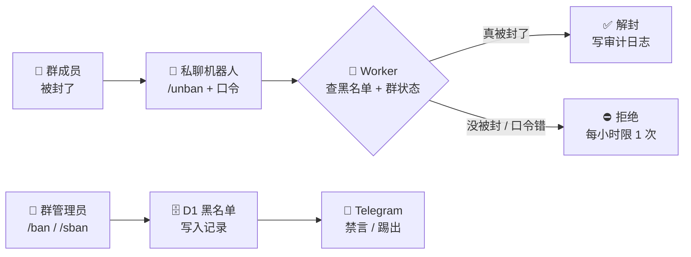
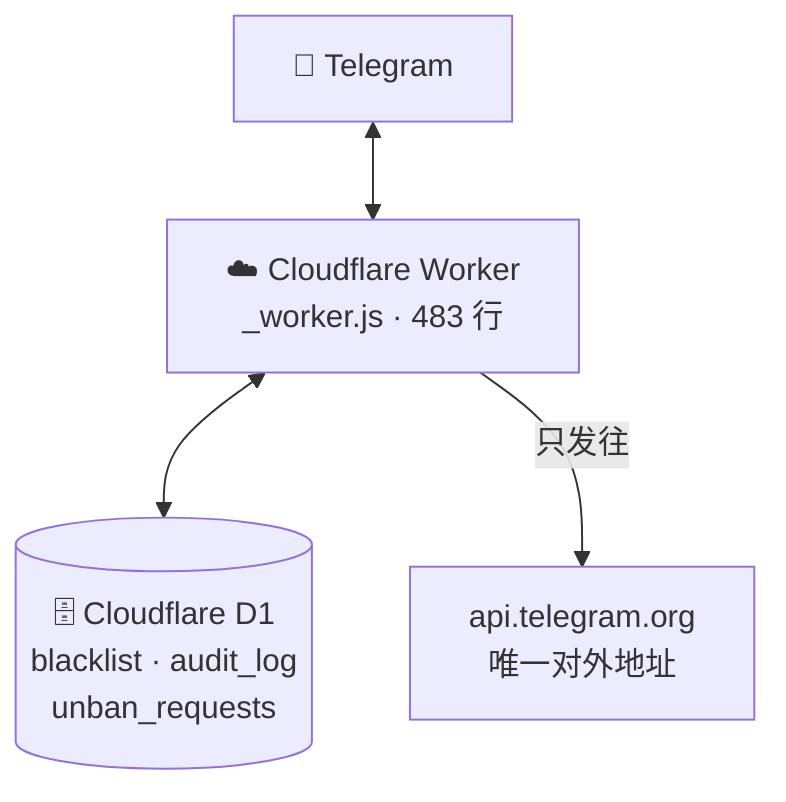
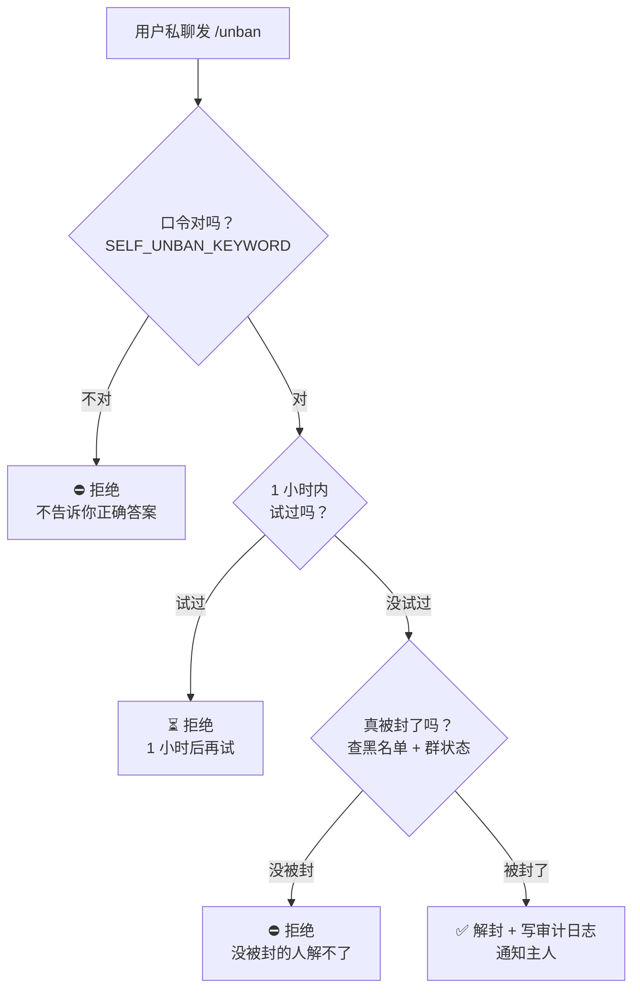
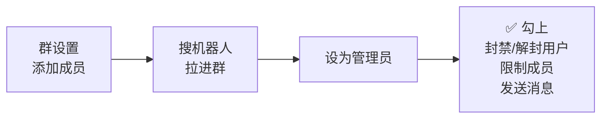

# 🤖 tgunban-lite

<p align="center">
  <b>精简版 Telegram 群组自助解封机器人</b><br>
  只做一件事：<b>自助解封 + 管理员封禁解封</b>，别的什么都不做。
</p>

<p align="center">
  
  
  
  
  
  
  
</p>

> 💡 **为什么要写这个？**
>
> 原项目 [xtgm/TGUnbanBot-Plus](https://github.com/xtgm/TGUnbanBot-Plus) 功能很全，但 `_worker.js` 有 **2.9 MB、47,480 行**，还带着公开的默认自助解封口令、外部 GKY 黑名单、AI 检测层、杀手群 / 演练 / 投票等一堆复杂模式。
>
> 这个版本把它们**全部砍掉**，只留核心，483 行、20 KB，改得动、查得清、用得稳。

---

## 🗺️ 一张图看懂它怎么工作





| 这一版有什么 | 这一版没有 ❌ |
| --- | --- |
| ✅ 自助解封（带限流 + 真封禁校验） | ❌ AI 广告检测（误判率高、烧额度） |
| ✅ 管理员 /ban /sban /unban /check | ❌ 外部黑名单（GKY 联查、联合封杀） |
| ✅ 黑名单导出 / 清扫、审计日志 | ❌ 杀手群 / 独立群 / 演练 / 举报投票 |
| ✅ Webhook 校验、SQL 参数化、输出转义 | ❌ 网页后台、Telegram 小程序、素材指纹 |

---

## 📋 功能一览

| 命令 | 谁能用 | 干什么 | 图解 |
| --- | --- | --- | --- |
| `/start` | 所有人 | 👋 欢迎与使用说明 | — |
| `/unban`（私聊） | 被封用户 | 🔓 粘贴完整口令自助解封，每人每小时 1 次，只有真被封禁 / 限制的人才能解 | 👇 流程图 ① |
| `/ban 用户ID [原因]` | 群管理员 | 🔇 禁言 + 写入黑名单 | — |
| `/sban 用户ID [原因]` | 群管理员 | 👢 踢出 + 写入黑名单 | — |
| `/unban 用户ID` | 群管理员 | ✅ 解封（先删黑名单记录，成功才调 Telegram 解封） | — |
| `/check 用户ID` | 群管理员 | 🔍 查黑名单 + 群内状态 | — |
| `/blacklist` | 群管理员 | 📋 最近 30 条黑名单 | — |
| `/health` | 管理员 | 💓 机器人身份、群数、黑名单总数 | — |
| `/stats` | 群管理员 | 📊 本群黑名单数 + 各类操作计数 | — |

### ① 自助解封流程



### HTTP 接口（都要带 TOKEN 路径密钥）

| 接口 | 干什么 |
| --- | --- |
| `GET /{TOKEN}` | 🔗 注册 Webhook + 设置命令菜单 |
| `GET /{TOKEN}/export?format=json\|csv` | 📤 导出黑名单（最多 1000 条） |
| `GET /{TOKEN}/purge?limit=20` | 🧹 把仍在群里的黑名单用户踢出（每批最多 50 人） |

---

## 🛠️ 部署教程（跟着图走，10 分钟跑起来）

### 第 0 步 · 准备三样东西

| # | 东西 | 去哪拿 |
| --- | --- | --- |
| 1️⃣ | 🤖 Telegram 机器人 Token | Telegram 里找 [@BotFather](https://t.me/BotFather)，`/newbot` 建一个 |
| 2️⃣ | ☁️ Cloudflare 账号 | [dash.cloudflare.com](https://dash.cloudflare.com) 注册登录 |
| 3️⃣ | 💻 本机装 Wrangler | `npm install -g wrangler`，然后 `wrangler login` |

> ⚠️ **单独建一个管理机器人，不要和测速推送机器人共用一个号** —— Telegram 429 限流是按机器人算的，一个号被限流会连累另一个。

### 第 1 步 · 建 D1 数据库

```bash
wrangler d1 create tgunban-lite
```

```
✅ 成功会返回一段 database_id，类似：
   database_id = "xxxxxxxx-xxxx-xxxx-xxxx-xxxxxxxxxxxx"
```

把这串 `database_id` 填进 `wrangler.toml` 里，替换掉那串 `00000000-…` 占位符：

```toml
[[d1_databases]]
binding = "DB"
database_name = "tgunban-lite"
database_id = "xxxxxxxx-xxxx-xxxx-xxxx-xxxxxxxxxxxx"  # 👈 换成你自己的
```

> 🗄️ 表结构（`blacklist`、`audit_log`、`unban_requests`）由代码首次运行时自动建立，**不用手动写 SQL**。

### 第 2 步 · 把机器人拉进群并给管理员



权限不够的话，机器人封不了人、也收不到 `chat_member` 事件，命令会直接报错。

### 第 3 步 · 设置 6 个密钥（最重要的一步）

```bash
wrangler secret put BOT_TOKEN           # ① BotFather 给的机器人 token
wrangler secret put TOKEN               # ② 管理接口的路径密钥，自己生成长随机串，不是 Bot Token
wrangler secret put WEBHOOK_SECRET      # ③ Webhook 校验密钥，A-Za-z0-9_-，建议 32 位以上随机串
wrangler secret put GROUP_ID            # ④ 目标群 ID，如 -1001234567890，多群用逗号分隔
wrangler secret put OWNER_IDS           # ⑤ 主人 TGID，第一个是主人
wrangler secret put SELF_UNBAN_KEYWORD  # ⑥ 自助解封口令，自己定一句，没默认值
```

> 🔐 **全部用 `wrangler secret put` 设置，不要写进代码、不要写进 `wrangler.toml`、不要发在聊天里。**
>
> 生成随机串可以用：`openssl rand -hex 16`（TOKEN、WEBHOOK_SECRET 各生成一个，别共用）。

| 变量 | 必填 | 说明 |
| --- | --- | --- |
| `BOT_TOKEN` | 是 | BotFather 给的机器人 token |
| `TOKEN` | 是 | 管理 HTTP 接口的路径密钥，**自己生成长随机串** |
| `WEBHOOK_SECRET` | 是 | Telegram Webhook 校验密钥，`A-Za-z0-9_-`，1–256 位 |
| `GROUP_ID` | 是 | 目标群 ID，逗号分隔可多群，第一个是主群 |
| `OWNER_IDS` | 建议 | 主人 / 副主人 TGID，逗号分隔；不填则不发主人通知 |
| `SELF_UNBAN_KEYWORD` | 是 | 自助解封口令，**没有默认值**。不填时自助解封直接拒绝 |

### 第 4 步 · 部署

```bash
wrangler deploy
```

```
✅ 看到类似下面的输出就是成功了：
   Total Upload: 20 KB
   Your Worker has access to the following bindings: D1
   Deployed tgunban-lite triggers (0.5 sec)
   https://tgunban-lite.<你的子域名>.workers.dev
```

### 第 5 步 · 注册 Webhook（浏览器打开一次就行）

```
https://tgunban-lite.<你的子域名>.workers.dev/{TOKEN}
```

把 `{TOKEN}` 换成第 3 步里你自己设的那个 TOKEN。看到 `{"ok":true}` 就说明 Webhook 注册好了，机器人开始接消息。

### 第 6 步 · 验证一下 ✅

| 在哪试 | 发什么 | 应该看到什么 |
| --- | --- | --- |
| 私聊机器人 | `/start` | 👋 欢迎与使用说明 |
| 群里（管理员） | `/health` | 💓 机器人身份、群数、黑名单总数 |
| 群里（管理员） | `/check 123456` | 🔍 该用户的黑名单 + 群内状态 |
| 私聊机器人（被封用户） | `/unban` | 🔓 按提示粘贴完整口令 |

---

## 🔒 安全说明（这个版本修掉了什么）

| 原项目的弱点 | 这一版怎么修的 |
| --- | --- |
| 😱 自助解封口令是公开的，写在源码和 README 里 | ✅ **口令没有默认值**，不填直接拒绝，不存在“公开默认口令” |
| 🕳️ Webhook 没校验就读数据库 | ✅ **先校验再碰 D1**，secret 不对直接 401，缺失直接 503 |
| 💉 用户输入拼进 SQL | ✅ **SQL 全部参数化**，`prepare().bind()`，TGID、原因、口令从不拼进 SQL |
| 🧪 输出没转义 | ✅ **输出全部转义**，拼进 Telegram HTML 的内容都过 `escapeHtml()` |
| 🕵️ 对外乱请求、查外部黑名单 | ✅ **对外只发 `api.telegram.org`**，不查 GKY、不调 AI |
| 🔑 密钥写在代码里 | ✅ **没有 eval、没有硬编码密钥**，源码里找不到任何 token、密码 |
| 🔁 自助解封能无限刷 | ✅ **每人每小时 1 次**，成功失败都计；解封前先确认真被封了 |
| 👑 谁都能封人 | ✅ **权限分层**：只在配置群内、发令人是群管理员或主人时才执行；不能封自己、不能封主人 |

> ⚠️ **不要在主账号上部署代理类 Worker**：本项目本身只是群管机器人，风险低；但如果你同时在同一个 Cloudflare 账号上部署 VLESS 等代理 Worker，有 1101 / 封号风险，代理请用小号。

---

## 📁 文件

| 文件 | 说明 |
| --- | --- |
| `_worker.js` | 全部代码，单文件，483 行 |
| `wrangler.toml` | Wrangler 配置，`database_id` 是占位符，部署前必须替换 |
| `README.md` | 本文件（图文教程） |
| `LICENSE` | MIT 许可证 |

## 🙏 致谢

- 原项目 [cmliu/CF-Workers-TGUnbanBot](https://github.com/cmliu/CF-Workers-TGUnbanBot) —— 最初的自助解封机器人设计
- 二改项目 [xtgm/TGUnbanBot-Plus](https://github.com/xtgm/TGUnbanBot-Plus) —— 本项目的审查对象与功能参考

## 📄 许可证

MIT License —— 自由使用、修改、再发布，保留原作者版权声明即可。
